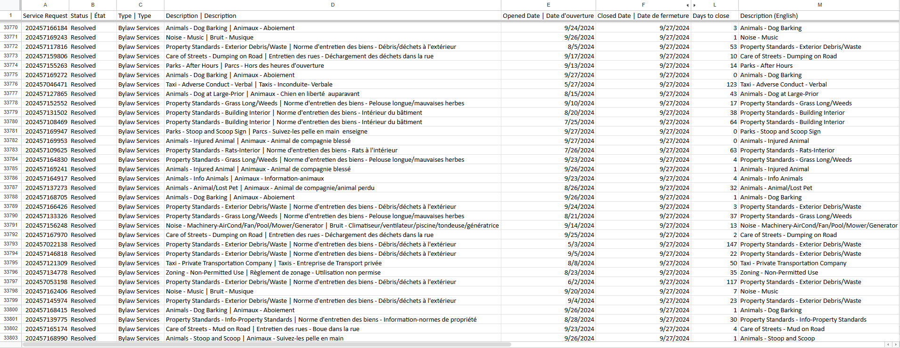
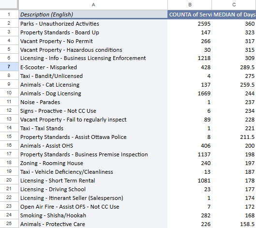
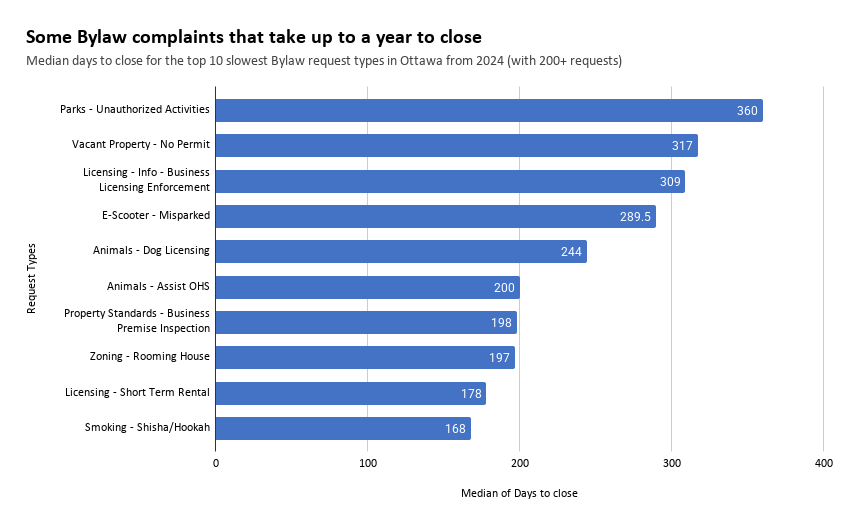

**November 5th, 2026**<br>
**MPAD2003A - Introductory Data Storytelling**<br>
**Adam Seummalavanh**<br>
**Presented to Jean-Sébastien Marier**<br>

# Deliverable 2: Exploratory Data Analysis (EDA)

Use one hashtag symbol (`#`) to create a level 1 heading like this one.

## Foreword

For this assignment, you must clean and analyze the dataset from Deliverable 1, create exploratory charts/visualizations, and identify a potential story. Your assignment must clearly detail your process. You are expected to write about 1,000-1,200 words, and to include several screen captures showing the different steps you went through. Your assignment must be written with the Markdown format and submitted on GitHub.

I have been assigning different versions of this project to my digital journalism and data storytelling students for a few years now. Its structure was inspired by the main sections/chapters of [*The Data Journalism Handbook*](https://datajournalism.com/read/handbook/one/). This version was further inspired by the [Key Capabilities in Data Science](https://extendedlearning.ubc.ca/programs/key-capabilities-data-science) program offered by the University of British Columbia (UBC).

**Here are some useful resources for this assignment:**

* [GitHub's *Basic writing and formatting syntax* page](https://docs.github.com/en/get-started/writing-on-github/getting-started-with-writing-and-formatting-on-github/basic-writing-and-formatting-syntax)
* [The template repository for this assignment in case you delete something by mistake](https://github.com/jsmarier/jou4100_jou4500_mpad2003_project2_template)

Did you notice how to create a hyperlink? In Markdown, we put the clickable text between square brackets and the actual URL between parentheses.

And to create an unordered list, we simply put a star (`*`) before each item.

## 1. Getting Data

Use two hashtag symbols (`##`) to create a level 2 heading like this one.

To include a screen capture, use the sample code below. Your images should be saved in the same folder as your `.md` file.

<br>
*Figure 1: The "Import file" prompt on Google Sheets.*

**Here are examples of functions and lines of code put in grey boxes:**

1. If you name a function, put it between "angled" quotation marks like this: `IMPORTHTML`.
1. If you want to include the entire line of code, do the same thing, albeit with your entire code: `=IMPORTHTML("https://en.wikipedia.org/wiki/China"; "table", 5)`.
1. Alternatively, you can put your code in an independent box using the template below:

```
=IMPORTHTML("https://en.wikipedia.org/wiki/China"; "table", 5)
```
This also shows how to create an ordered list. Simply put `1.` before each item.


### My Deliverable 2
For this assignment, I analyzed a City of Ottawa dataset about 311 Service Requests from 2024. I focused on Bylaw Service Requests and how long they take to close.

[Open Ottawa dataset link](https://open.ottawa.ca/documents/37623f4b4c6440e792b0a75012c4405b/about)

### How I imported the data into Google Sheets

1. From the Open Ottawa "2024 Service Requests" link provided, I downloaded the data by clicking the "Download" button.

2. I opened *Google Drive*, clicked on "New", and imported the data under "File upload"

3. After it finishes uploading, I clicked the three dots to the right of the file. From there, I went to "Open with" > "Google Sheets"

4. The dataset is large, but you should see the dataset once it loads.

.png>)<br>
*Figure 1: The 311 Service Requests Dataset in Google Sheets immediately after importing.*

[My Google Sheets of the Dataset](https://docs.google.com/spreadsheets/d/1YMwSm1Dj2-DSZF6gLM9tkGmtZRMoH25v/edit?usp=sharing&ouid=112580467285726575425&rtpof=true&sd=true)

### General Observations of the Dataset

The 311 Dataset has 319,311 lines/rows (excluding the headings) and 11 columns in total. But filtering to Bylaw Services will leave us with only 55,920 rows. This dataset seems to be missing things in some columns. Therefore, it needs to be cleaned up before we can use it.

**The three columns I'm using for this deliverable**

The three columns I chose to create my story are:

1. **The Description** - This is one of the most important columns because it tells us the type of Bylaw request that is being dealt with. This column has Nominal variables like "Animals" and "Noise"

2. **Opened date** - This is the date of the call/request. This will be crucial for when we compare it with the third column. This column deals with discrete variables that deal with whole days that the requests were made.

3. **Closed date** - This is the date when the call/request has been resolved. Some requests take longer than others to resolve/process, which is what I want my thesis to be about. This column also deals with discrete variables that represent whole days that the requests were resolved.

### My Thesis/question

**From the 311 Service Request in 2024, What Service Requests take the longest time to close?**

## 2. Understanding Data

### 2.1. VIMO Analysis

Use three hashtag symbols (`###`) to create a level 3 heading like this one. Please follow this template when it comes to level 1 and level 2 headings. However, you can use level 3 headings as you see fit.

### My Analysis

I used VIMO to check the quality of the description, opened dates, and closed dates columns. According to Statistics Canada's video on the VIMO Analysis, valid data is data that isn't blank and within a valid range; invalid data has impossible values; missing data is left blank; and an outlier has data with really big or small values (Government of Canada, Statistics Canada, 2026).

**Valid:** The Opened dates data is valid; every date falls within 2024, and no request has a closed date before its opened date. Though the dates only show as days, so we can't really go any more in depth.

**Invalid:** The Closed dates data is invalid, as there are a few rows that show "/N", meaning there is no closed date. The description is also inconsistent because some categories like Noise had the French translation, but some rows were only in English.

**Missing:** There are 219 requests that do not have a closed date because they are still labeled as "Active". Outside of my main 3 columns, it's also worth noting that nearly all of the addresses, latitudes, and longitudes are missing, but I assume that it's because it wouldn't feel right to have hundreds of thousands of people's addresses out in the open.

**Outliers:** The median request took 7 days to close, but the average was 71 days, and the longest request to close took 610 days.

Support your claims by citing relevant sources. Please follow [APA guidelines for in-text citations](https://apastyle.apa.org/style-grammar-guidelines/citations).

**For example:**

As seen in Bounegru & Gray (2011), a data visualization should be clear...

### 2.2. Cleaning Data

To clean the data, I used six methods that I learned from "Module 7: Finding a Story" (Marier, 2026):

1. **Sorting and copying:** I sorted the full dataset by type (A to Z), which grouped the Bylaw services rows together. Then, I copied those 55,920 rows into a new sheet labeled "Bylaw".

2. **Removing duplicates:** I used Data > Data cleanup > Remove duplicates on the "Service Request ID" column, which had no duplicates.

3. **Finding and replacing:** I counted the `\N` placeholders in the "Closed date" column first, then replaced every `\N` with a blank cell using Edit > Find and replace (matching the entire cell contents).

```
=COUNTIF(F2:F55921)
```

4. **Splitting:** Each description containing both English and French text has been separated by a '|'. I split it so I had an English column to work with, then pasted the results as their respective values.

```
=SPLIT(D2, "|")
```

5. **Trimming whitespace:** I used the "Trim whitespace" under Data cleanup on the new columns I made (the English and French descriptions) to remove the space left before the "|". It changed 91, 130 cells.

6. **Freezing rows:** I froze the header row (from View > Freeze > 1 row) so the column names stayed visible while I scrolled through the different rows.

7. **Sorting again:** Finally, I sorted by Closed date (A to Z), which moved the 219 requests with no closed date to the bottom of the dataset. I then made a "days to close" column by subtracting the opened date from the closed date, and filled it down to the last request that had a closed date (row 55,702):

```
=F2-E2
```
<br>
*Figure 2: The Bylaw dataset after cleaning. Description (English) is the result of the `SPLIT`, and "Days to close" is "Closed date" - "Opened date". The header row is frozen.*
### 2.3. Analyzing Data

I chose Description and Days to close because my question is which types of Bylaw requests take the longest to close. I first lookeda at the whole Days to Close column:

```
=AVERAGE(L2:L55702)
=MEDIAN(L2:L55702)
=STDEV(L2:L55702)
=MODE(L2:L55702)
```
The average is about 71 days, the median is 7 days, the standard deviation is about 122, and the mode is 0. The average was far above the median, so a few very slow requests pull it up. For that reason, I used the median in my pivot table.

The pivot table has the "Description (English) in the rows. The values are the `COUNTA` of Service Request ID, which counts the requests in each type, and the `MEDIAN` of Days to close. I sorted it by the median, from highest to lowest.

<br>
*Figure 3: This pivot table shows the number of requests and median days to close for each Bylaw request type.*

I then charted the 10 slowest types that have at least 200 requests. I left out smaller types because I thought a median based on a few requests isn't reliable. An example of this is "Taxi - Bandit/Unlicensed," which has a median of 275 days, but only 4 requests.


<br>
*Figure 4: This exploratory chart shows the median days to close for the 10 slowest Bylaw request types with 200+ requests.*

I used a horizontal bar chart because bars that start at the same baseline are easier to compare by length. There's only one category that we are measuring/tracking (Median for Days to close).

"Parks - Unauthorized Activities" stood out among the rest and had a median of 360 days across 2,595 requests, which is the slowest of any large type. Licensing was also slow: "Licensing - Info - Business Licensing Enforcement" has a median of 309 days, and "Animals - Dog Licensing" has 244 days. On the contrary, "Noise - Music", the type with the most requests (roughly 5,000), has a median of 0 days, which implies that most of them got resolved on the same day.

I learned that "slow" Bylaw service depends on the type of request. Complaints that need a quick response are closed right away, while parks and licensing requests take most of a year.

## 3. Delivering Data

### My story idea

The story I would want to dig into is the gap between how fast Bylaw services respond to complaints and how long some requests take to close. In my data, noise complaints are usually closed the same day, but requests about unauthorized activities in parks have a median of 360 days.

This pattern is similar to Ted Raymond's article about the concerning workloads that Bylaw officers deal with. Althought this article deals with response times rather than closed dates, it confirms what we have in the dataset when Raymond says, "Officers are only responding to lower priority calls, such as maintenance complaints, within 96 hours around 74 per cent of the time, below the target of 80 per cent." (Raymond, 2024)

### What else I would need for my story

I would like to interview a Bylaw official or officer, because I feel like they would know about the different calls they get better than anyone. I would need more answers from city and Bylaw officials and how it defines "closed" and what reason is recorded when a request is closed. I would like to know if requests close after an officer visits or when a staff member updates a record or something else.

Aside from the interview, I would also want to look into the 311 Service Requests from other years, like in 2023 or 2025, to compare and see if there's a pattern in the days to close.

## 4. References

Include a list of your references here. Please follow [APA](https://apastyle.apa.org/style-grammar-guidelines/references) or [MLA](https://www.mla.org/MLA-Style) guidelines for references. Hanging paragraphs aren't required though.

**Here's an example:**

Bounegru, L., & Gray, J. (Eds.). (2021). *The Data Journalism Handbook 2: Towards A Critical Data Practice*. Amsterdam University Press. [https://ocul-crl.primo.exlibrisgroup.com/permalink/01OCUL_CRL/hgdufh/alma991022890087305153](https://ocul-crl.primo.exlibrisgroup.com/permalink/01OCUL_CRL/hgdufh/alma991022890087305153)


### My References

Marier, J.-S. (2026). *Basic Data Analysis Techniques* [Video]. MPAD 2003A, Module: 7 Finding a Story. Carleton University. https://brightspace.carleton.ca/d2l/le/content/451355/viewContent/4810876/View

Raymond, T. (2024, May 17). *Workload concerns could prompt call for more bylaw officers in Ottawa*. CTV News Ottawa. https://ottawa.ctvnews.ca/workload-concerns-could-prompt-call-for-more-bylaw-officers-in-ottawa-1.6892348

Statistics Canada. (2020, September 23). *Data accuracy and validation: Methods to ensure the quality of data* [Video]. https://www.statcan.gc.ca/en/wtc/data-literacy/catalogue/892000062020008

I used Claude AI to help me count the number of Bylaw Services out of the over 300,000 requests from the original dataset. I also used Claude AI to help me with how to write my citations. I tried using Citation Machine on the internet for my last deliverable, but I got points taken off for that so I asked Claude AI to help me with that.

I also used Grammarly to fix any spelling mistakes that I had.