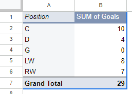

**November 5th, 2026**<br>
**MPAD2003A - Introductory Data Storytelling**<br>
**Adam Seummalavanh**<br>
**Presented to Jean-Sébastien Marier**<br>

# Deliverable 2: Exploratory Data Analysis (EDA)

Use one hashtag symbol (`#`) to create a level 1 heading like this one.

## Foreword

For this assignment, you must clean and analyze the dataset from Deliverable 1, create exploratory charts/visualizations, and identify a potential story. Your assignment must clearly detail your process. You are expected to write about 1,000-1,200 words, and to include several screen captures showing the different steps you went through. Your assignment must be written with the Markdown format and submitted on GitHub.

I have been assigning different versions of this project to my digital journalism and data storytelling students for a few years now. Its structure was inspired by the main sections/chapters of [*The Data Journalism Handbook*](https://datajournalism.com/read/handbook/one/). This version was further inspired by the [Key Capabilities in Data Science](https://extendedlearning.ubc.ca/programs/key-capabilities-data-science) program offered by the University of British Columbia (UBC).

**Here are some useful resources for this assignment:**

* [GitHub's *Basic writing and formatting syntax* page](https://docs.github.com/en/get-started/writing-on-github/getting-started-with-writing-and-formatting-on-github/basic-writing-and-formatting-syntax)
* [The template repository for this assignment in case you delete something by mistake](https://github.com/jsmarier/jou4100_jou4500_mpad2003_project2_template)

Did you notice how to create a hyperlink? In Markdown, we put the clickable text between square brackets and the actual URL between parentheses.

And to create an unordered list, we simply put a star (`*`) before each item.

## 1. Getting Data

Use two hashtag symbols (`##`) to create a level 2 heading like this one.

To include a screen capture, use the sample code below. Your images should be saved in the same folder as your `.md` file.

<br>
*Figure 1: The "Import file" prompt on Google Sheets.*

**Here are examples of functions and lines of code put in grey boxes:**

1. If you name a function, put it between "angled" quotation marks like this: `IMPORTHTML`.
1. If you want to include the entire line of code, do the same thing, albeit with your entire code: `=IMPORTHTML("https://en.wikipedia.org/wiki/China"; "table", 5)`.
1. Alternatively, you can put your code in an independent box using the template below:

``` r
=IMPORTHTML("https://en.wikipedia.org/wiki/China"; "table", 5)
```
This also shows how to create an ordered list. Simply put `1.` before each item.


### My Deliverable 2
For this assignment, I analyzed a City of Ottawa dataset about 311 Service Requests in 2024. More specifically, I looked at the Bylaw services, the different request types, and the amount of requests in said request types.

[Open Ottawa dataset link](https://open.ottawa.ca/documents/37623f4b4c6440e792b0a75012c4405b/about)

### How I imported the data in Microsoft Excel

1. From the Open Ottawa "2024 Service Requests" link provided, I downloaded the data by clicking the "Download" button.

2. From there, I opened *Google Drive*, clicked on "New" near the top left of the screen, and imported the data under "file upload"

3. After it's done uploading, I checked where my dataset was located. Once I found where it was, I clicked on the three dots on the right of the file. From there, I went to "Open with" and clicked "Google Sheets"

4. It'll take a minute because the dataset is really big but once it's done loading, you should see the data set.

.png>)<br>
*Figure 1: The 311 Service Requests Dataset in Google Sheets immediately after importing.*

[My Google Sheets of the Dataset](https://docs.google.com/spreadsheets/d/1YMwSm1Dj2-DSZF6gLM9tkGmtZRMoH25v/edit?usp=sharing&ouid=112580467285726575425&rtpof=true&sd=true)

### General Observations of the Dataset

The 311 Dataset has 319,311 lines/rows (excluding the headings) and 11 columns in total. As I've mentioned though, we are focusing solely on the Bylaw Requests, so that would leave us with 55,920 rows. This dataset seems to be missing things in some columns, such as the description, closed dates, latitude and longitude, etc. Therefore, It would need to be cleaned up in order to use it.

**The three columns I'm using for this deliverable**

The three columns I chose to create my story are:

1. **The Description** - This is one of, if not, the most important columns because it tells us the type of Bylaw request that is being dealt with.

2. **Opened date** - This is the date of the call/request. This will be crucial for when we compare it with the last columns of my choosing

3. **Closed date** - This is the date of when the call/request has been resolved. Some requests take longer than others to resolve/process, which is what I want my thesis to be about. Though it seems like some dates are missing, which we will have to clean up later.

### My Thesis/question

**From the 311 Service Request in 2024, Do some requests take longer and which ones take the shortest vs the longest?**

## 2. Understanding Data

### 2.1. VIMO Analysis

Use three hashtag symbols (`###`) to create a level 3 heading like this one. Please follow this template when it comes to level 1 and level 2 headings. However, you can use level 3 headings as you see fit.

Insert text here.

Support your claims by citing relevant sources. Please follow [APA guidelines for in-text citations](https://apastyle.apa.org/style-grammar-guidelines/citations).

**For example:**

As seen in Bounegru & Gray (2011), a data visualization should be clear...

### 2.2. Cleaning Data

Insert text here.

### 2.3. Analyzing Data

Insert text here.

**This section should include a screen capture of your pivot table, like so:**

<br>
*Figure 2: This pivot table shows...*

**This section should also include a screen capture of your exploratory chart, like so:**

<br>
*Figure 3: This exploratory chart shows...*

## 3. Delivering Data

Insert text here.

## 4. References

Include a list of your references here. Please follow [APA](https://apastyle.apa.org/style-grammar-guidelines/references) or [MLA](https://www.mla.org/MLA-Style) guidelines for references. Hanging paragraphs aren't required though.

**Here's an example:**

Bounegru, L., & Gray, J. (Eds.). (2021). *The Data Journalism Handbook 2: Towards A Critical Data Practice*. Amsterdam University Press. [https://ocul-crl.primo.exlibrisgroup.com/permalink/01OCUL_CRL/hgdufh/alma991022890087305153](https://ocul-crl.primo.exlibrisgroup.com/permalink/01OCUL_CRL/hgdufh/alma991022890087305153)
